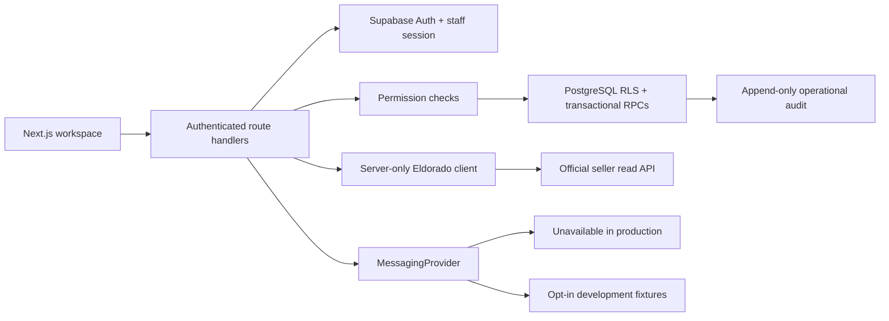

# Architecture and security boundaries

## Domains

- **Authentication:** verified Supabase user, HTTP-only cookie refresh, TOTP setup/verification, invitation confirmation and password setup.
- **Authorization:** six staff roles, explicit override grants/denies, per-assignment order access, database policy enforcement. Privileged roles require AAL2 in both the app and SQL.
- **Eldorado:** token acquisition/reuse/renewal, validated reads, controlled timeouts, no automatic mutation retry.
- **Orders:** sanitized normalization, atomic page/history synchronization, assignment/context queries and internal notes.
- **Offers:** documented read endpoint inventory and separate local storage. Read contracts were validated for flexible/predefined/item listing categories. These have real read-only adapters; currency request and commercial-write contracts remain unverified.
- **Inventory:** metadata, separate ciphertext storage, transactional reservation with row locks and a partial unique index.
- **Messaging:** abstract provider, unavailable provider, opt-in synthetic provider. No live messaging provider or credentials have been fabricated. Local template assistance is separate from external AI and cannot send messages.
- **Team:** Owner-confirmed Auth invitations, active membership, approved access changes, immediate staff-session revocation.
- **Approvals:** intent records, unique idempotency keys, row-locked decisions, distinct reviewers, internal permission-change execution; external write adapter intentionally unavailable.
- **Audit:** internally generated events in the same transaction as supported database mutations. Authenticated users have no insert/update/delete grant.
- **Analytics:** count/status metrics and completed volume grouped by currency, explicitly limited to up to 1,000 visible synchronized records.

## Trust boundaries

Browser requests never carry the Eldorado client secret or seller token. Supabase's public publishable key is intended to be public; the service-role binding is never public. All APIs verify individual employee identity. RLS independently prevents unassigned reads and direct table mutations. Service-role usage is narrow and never passed into a user-requested generic query.

Mutations validate exact origin and JSON bodies, enforce streamed body-size limits, validate inputs with Zod, and use database RPCs for atomic permission checks/audit. Durable SQL rate-limit buckets protect synchronization and invitation operations. Supabase Auth supplies authentication rate limits; wider mutation throttling and distributed abuse monitoring need staging validation.

Session registration cannot reactivate a revoked JWT session ID. A fresh sign-in produces a new session. A deactivated staff record remains blocked even with a previously issued JWT. Elevated roles require verified MFA assurance. Session/override changes are enforced again by the database.

Order persistence intentionally excludes tracking attributes, IP addresses, payment identifiers, and raw upstream payloads. Inventory secret ciphertext has no authenticated database SELECT grant; a separately permissioned, audited server retrieval workflow decrypts on demand. The browser does not cache the plaintext in TanStack Query; the revealed display clears after 30 seconds or closing. A key rotation strategy must be completed before operational secret delivery.

## Known limits

This is a single-organization private workspace, not a tenant-isolated multitenant SaaS. It must not be offered to multiple organizations without adding organization keys and policies.

The local SQL harness provides synthetic Supabase-compatible auth helpers. Real Supabase gateway/JWT, SMTP, refresh propagation, recovery, and hosting behavior require independent staging tests. The real local Supabase stack was additionally exercised with passwords, MFA, invitation delivery, signed JWTs, RLS, permissions and actual official seller reads. No claim of hosted readiness follows from local SQL/Auth success.

External write execution needs verified official state transitions, payload schemas, fresh upstream reads before/after each operation, durable operation IDs, lock/lease ownership, ambiguous-result recovery, and explicit authorization. None of those are replaced by an approval record. The adapter remains disabled.
